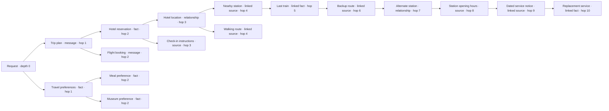

# Cortex memory effort — design for discussion

2026-10-14 · Revision 4 (execution resumed; K29 baseline added; approved effort settings retained) · **Implementation resumed by direct user authorization.**

Repository: **SaintNick1214/Project-Cortex**, checkout `worktrees/backend-runtime-completion`. This is a proposed goal refinement, not an implementation or a new runtime acceptance claim. The separate **SaintNick1214/cortexmemory.dev** documentation repository and **Project-Cortex-Proofs** sandbox have not been changed for this design.

## What we have agreed

Memory effort means **how far Cortex may follow memory connections to answer this request**. The user explicitly chose traversal depth, with a separate cap on entries.

| Effort | Maximum traversal depth | Hosted submit → first visible answer target | Meaning |
| --- | ---: | ---: | --- |
| **Fast** | **2 hops** | **3 seconds** | Retrieve direct matches and their relevant immediate connections. |
| **Normal — default** | **4 hops** | **6 seconds** | Follow relevant connections up to four steps from the request. |
| **High** | **8 hops** | **8 seconds** | Follow useful paths up to eight steps, with separately bounded selection and work. |
| **Max** | **No preset depth limit** | **30 seconds** | Continue useful traversal until the available context, relevance, time, cost or work limits stop it. |

These are *ceilings*, not instructions to fill every slot or to search every branch. High includes eligible results at depths 1 through 8. Max is not “depth 10”; ten hops are used below only to make a finite example visible. Normal (4 hops) is the user-selected default when no effort is requested. These latency targets supersede the earlier under-1-second design target; they are targets, not new measured results.

Changing effort does not delete or reduce stored history. The complete canonical transcript remains one message per row with its metadata and provenance. Old messages can be direct relevant matches at depth 1; depth does not mean message age or “last N turns.”

## What one hop means

The current request is the starting point, **depth 0**. A direct search match is **depth 1**. Following a meaningful relationship from that match reaches **depth 2**, and so on. If multiple paths reach the same evidence, use its shortest permitted path and include the evidence once.

A hop is a logical memory connection, not one SQL/Convex query, one HTTP request, one model call, or one row read. A vector match may need its chunk, source metadata and authorization records hydrated before it can be used. That still produces **one directly retrieved piece of evidence**, not several additional hops.

Examples of additional connections include a fact's supporting message, an entity's related fact, an explicit graph relationship, or relevant nearby conversation context. Loading the full content of a new supporting message adds another evidence entry; loading only the metadata required to verify an existing entry does not. A graph adapter is not required for ordinary message/fact/source links. It is required when the requested relationship exists only in that adapter; report such coverage as unavailable rather than inventing it.

A vector link is normally the route to a chunk or message, not an extra copy of that same text. A fact and its supporting message may be two useful entries if both add distinct information. Dedupe identical source content and keep citations rather than attaching message + chunk + vector copies of the same evidence.

## A concrete traversal example

Illustrative request: **“Help me plan Friday's trip.”** The following is one possible path through stored evidence, not a required retrieval order:



| Effort | What this path can add |
| --- | --- |
| **Fast · 2 hops · 3 s** | Direct trip plan/preferences plus relevant hotel/flight bookings and preference details linked to them. |
| **Normal · 4 hops · 6 s · default** | Can additionally reach location, check-in, nearby station and walking-route evidence. |
| **High · 8 hops · 8 s** | Can follow the chain through last-train details, backup route, alternate station and station opening hours. |
| **Max · no preset depth · 30 s** | Can additionally reach the dated service notice and replacement service, and continue while useful context and runtime budgets remain. |

A search could match “last train” directly when that is what the user asks about. It would then be a depth-1 match, even though the illustrative trip-planning path reaches it at depth 5. Deeper effort broadens discovery; it does not make directly relevant evidence artificially inaccessible.

## Why the amount of potential context can grow exponentially

In a tree with **two new connections from every memory**, the successive frontiers contain **2 → 4 → 8 → 16 → 32 → 64 → 128 → 256 → 512 → 1,024** entries. Count all visited levels, not only the last frontier:

| Effort | Depth in example | Entries at the deepest level | Potential entries across all visited levels | With proposed entry caps below and room for 64 entries |
| --- | ---: | ---: | ---: | ---: |
| Fast | 2 | 4 | **6** | **4** |
| Normal — default | 4 | 16 | **30** | **8** |
| High | 8 | 256 | **510** | **16** |
| Max | 10, example only | 1,024 | **2,046** | **64** |

With **three** new connections per memory, those cumulative totals become **12 / 120 / 9,840 / 88,572**. Real data has uneven branching, cycles, duplicate paths, inaccessible records and weak matches, so these are illustrations, not workload forecasts.

**Potential discovery can grow exponentially. The assembled request must stay bounded.** Even a shallow search can have huge fan-out, so depth alone cannot provide Fast's latency target. Limit candidate search and expansion work as well as the final prompt size.

## Two separate controls: depth and breadth

**Depth** controls which evidence is eligible to be discovered. **Breadth** controls how many unique, useful entries are ultimately attached. Token limits separately control how large those entries may be in total.

The following entry caps are **proposed starting values for discussion, not approved decisions**:

| Effort | Confirmed depth | Proposed optional-context entry cap |
| --- | ---: | ---: |
| Fast | 2 | 4 |
| Normal — default | 4 | 8 |
| High | 8 | 16 |
| Max | No preset depth cap | No preset entry count; fit the available context |

One shared entry cap covers selected historical messages, facts, vector-backed chunks, graph evidence and pending context; no automatic quota for each type. The result could be three messages and one fact, or one message and three facts, depending on relevance. This avoids multiplying a “4 entry” setting into 4 of every category. The current user message is required input, not an optional recalled entry.

Recent conversation continuity needs deliberate selection too. A relevant recent exchange can be included without scanning the complete history. Preserve chronological order for selected executable messages and keep required tool-call/result groups together. If a whole exchange contains two optional messages, it consumes two entry slots. Never silently split a required group to fit a count.

Entry counts are ceilings. Do not add irrelevant entries to fill them. Do not invent a new LLM summarization or reranking call to make the quota fit. Prefer relevant whole entries or existing independently addressable chunks; arbitrary truncation must not change stored content or lose source identity.

## Practical execution model

1. Resolve verified identity, scope, the requested effort and administrator policy. The effective depth, entries, input, cost and work limits cannot exceed the caller's permitted limits.
2. Find a small set of direct relevant candidates using existing indexed retrieval. Selecting effort does not by itself require an external model call. If semantic search needs a fresh query embedding, measure and account for that call explicitly.
3. For additional permitted hops, expand relevant relationships in bounded batches, maintain a visited set, and prune weak, stale, revoked or duplicate results. Track bounded search work independently of how many entries enter the prompt. Prefer useful paths rather than exhaustively walking the graph.
4. Rank the unique eligible evidence for this request. Provenance can be retained without copying every intermediate node's full text into the prompt. Include enough evidence to make a relationship intelligible; treat dependent evidence bundles together when necessary.
5. Assemble required instructions, the current turn, tools and intact required tool groups. Add selected history/evidence within both the entry cap and the remaining input-token budget. All included metadata and relationship labels consume tokens too.
6. Perform the existing final authority/currentness and billable-call admission checks, then stream the answer. Effort never skips these checks. Memory ingestion remains asynchronous; explicit strict barriers remain a separate choice with their own latency consequences.

Max fills *useful available context*, not every message through time. Its usable input is the smaller of the qualified input cap and the model context window after reserving output. Subtract required input, tool definitions and serialization safety margin before assigning space to optional evidence. The currently qualified input bound is **32,768 conservative input units**; Max cannot silently expand that bound to a model's larger advertised window. A broader policy requires its own qualification.

Max has no product-level hop or entry-count cap, but still needs bounded pages, cancellation, visited-node deduplication, a finite request deadline and cost/work limits. Reaching a runtime limit is observable partial retrieval, not a claim that the memory graph was exhausted.

## Latency contract for every effort

The **3 / 6 / 8 / 30 second targets** for Fast / Normal / High / Max measure ordinary hosted chat **submission → first visible model-generated answer text**, including client→Convex, authentication/admission, memory retrieval, Gateway/model first token and delivery/paint. A spinner, acknowledgement, replayed response or memory-retrieved text does not satisfy these targets. Full response completion is a different measurement. A standalone `memory.recall` also reports its own recall duration separately.

Limiting Fast to two hops is not proof that its 3-second target is met. Empty context has already been slow historically. Fix fixed orchestration overhead too; do not attribute all latency to graph depth. This design makes no claim of newly measured success. Allocate each retrieval deadline within the end-to-end target, leaving time for the model's first token and delivery; the full target cannot be spent on traversal alone.

Proposed behavior: stop optional expansion at its allocated time/work budget and expose the reason. Continue with less memory only when authorized consistency rules still permit it; never skip a mandatory strict barrier, authority fence or policy check. Do not silently raise effort, add a second paid answer call, or retry inference to hide a slow run. Record a miss against the requested mode's target, rather than silently moving it to a slower profile.

All four numerical targets need real hosted qualification. The modes trade discovery work for context; they do not guarantee a more correct answer or change the answer model's reasoning setting. The proposed Normal default must be consistent across the SDK, backend, CLI and demos when implemented.

## Product contract to design next

The same effort names and semantics should apply across public `memory.recall`, backend chat runs, the TypeScript client, CLI, AI SDK integration and canonical demos. The backend resolves and records effective policy; clients request effort rather than owning a separate traversal/tool loop.

Illustrative request fragment — **not a shipped API**:

```ts
memory: {
  effort: "fast" | "normal" | "high" | "max", // default: "normal"
  // Optional lower ceilings, still constrained by backend policy:
  maxEntries?: number,
  maxContextTokens?: number,
}
```

Return or trace: requested/effective effort, allowed/reached depth, visited/expanded/selected/deduplicated counts, entries by kind, selected input size, backend policy version, timing by stage, and stop reasons such as depth, relevance, entries, input, deadline, work, cancellation or unavailable stage. Keep evidence content out of ordinary telemetry. Distinguish “no matches” from “could not search.”

Pending but authorized evidence can supply a direct candidate without waiting for indexing. Effort must not promise access to unindexed semantic/graph links that do not yet exist. Track stage readiness and report missing coverage; do not wait for asynchronous memory completion on an ordinary Fast path.

## Current Gateway testing models

Checked locally against the saved receipts of disposable session `ee12c10d-424f-4c65-b1a5-1f4e64bdb8d2` and the applied sandbox policy on 2026-10-14. No new Gateway call was made for this check.

- **Chat replies and tool-capable chat:** `openai/gpt-4o-mini`. The saved terminal evidence reports the same model identifier. The `agent.respond` policy currently allows up to 256 output tokens per call.
- **Memory extraction:** `openai/gpt-4o-mini`.
- **Managed memory embeddings and ordinary query embeddings:** `openai/text-embedding-3-small`, 1,536 dimensions, profile `cortex-text-small-1536-v1`.
- Separate startup qualification probes also exercised `openai/gpt-4o` for titles, `openai/text-embedding-3-large` for the large-profile probe, and `openai/gpt-image-1` for images. These are not the ordinary chat reply model.

Source pointers: `Project-Cortex-Proofs/sandbox-env/templates/qualification-envelopes.json` (`agent.respond` model), `sandbox-env/runtime.mjs` (managed query-embedding selection), and session-local `receipts/read-runtimeModelAttempts-1792013864634.json` plus `receipts/runtime-ready.json` (saved actual model/profile evidence). Raw receipts and credential-bearing session state have not been copied into this design.

## Latest completed cloud latency measurements

The latest completed baseline is now **K29 `f87695783e8b21ffecf6298057a87cd8e69a3016`** on disposable hosted Convex. Browser first-visible replies measured **3.960s / 3.580s**, and CLI first-printed replies **6.855s / 6.981s**. Server preparation before main dispatch measured **2.168 / 1.808 / 4.400 / 4.759s**, respectively. The two CLI recall spans were **1.842s / 2.111s**. A separate public recall measured **3.393s** at the API boundary, including a **1.150s** embedding interval and **0.702s** after result attachment for reads and final delivery. These are individual observations before effort profiles, not percentile statistics or profile acceptance. Four-run memory, ordinary capture/recall, authorization and financial checks passed; the exact database, container and credentials were removed and their absence freshly verified. The original interrupted launcher exit remains unknown. See `k29-baseline-completion-v1.json`, `k29-four-run-critical-path-readonly.md` and `k29-public-recall-critical-path-readonly.md`.

The retained K28 measurements below were observed **October 14, 2026, 1:41–1:48 p.m. Pacific**, with source **`a773bd545c22e3c6eeb228b800d4c3a679375c5b`**. Workload, selected context and concurrency differ between generations, so the observations do not establish a causal speed ratio. The existing revision 3 inline chart still shows this historical K28 snapshot.

### What the user actually waited

| Observed run | Submission → first visible/printed answer |
| --- | ---: |
| Browser, first | **4.380 s**, after paint |
| Browser, warm | **3.766 s**, after paint |
| CLI, first | **7.705 s**, first stdout acknowledged |
| CLI, warm | **9.902 s**, first stdout acknowledged |

These runs predate the effort profiles. Comparing them with the new 3/6/8/30-second targets does not qualify any profile or prove its traversal behavior. The original under-1-second failures remain recorded as failures under that historical gate.

### Where the recorded server window went

These three columns are disjoint intervals on one server clock, from native admission entry through the first output mutation's completion. Their sum is the recorded server window, not the full client latency.

| Server interval | Browser first | Browser warm | CLI first | CLI warm |
| --- | ---: | ---: | ---: | ---: |
| Admission/preparation/recall → main model dispatch | **2.223 s** | **2.087 s** | **5.305 s** | **6.949 s** |
| Main Gateway dispatch → first processed text | **0.668 s** | **0.481 s** | **0.497 s** | **0.535 s** |
| First processed text → first output mutation completion | **0.637 s** | **0.503 s** | **0.557 s** | **1.023 s** |
| **Recorded server window** | **3.528 s** | **3.071 s** | **6.359 s** | **8.507 s** |

The largest recorded block is before the answer model dispatch. Browser fits included **zero recalled memories, facts or pending entries**, so their 2.1–2.2 seconds of preparation cannot be attributed to a large recalled context. CLI preparation included private Agent recall of **1.976 / 3.172 seconds**; its actual embedding calls were **0.312 / 0.336 seconds**, already inside those recall intervals.

The Gateway interval combines routing, external provider work, transfer and local stream processing. These traces do **not** split Gateway routing from the external model. The server window and client total have separate clocks/boundaries. Do not add them together, or label their numerical difference as measured network latency. Final protected observe/session client pairs also overlap server work; they are not extra serial phases to add to this table.

### One actual public `memory.recall`

The public API returned **5 items / 279 context bytes** in **3.702 seconds**. Its action RPC took **3.333 seconds**, with **0.174 / 0.195 second** pre/post session RPCs. The separately measured native action window was **3.214 seconds**:

| Disjoint native action group | Time |
| --- | ---: |
| Preparation, authority/budget setup and governed admission, through embedding dispatch | **0.891 s** |
| Query embedding dispatch → ready | **0.317 s** |
| Terminal capture, result attachment and surrounding handoffs | **0.516 s** |
| Read preparation, matching and ranking/handoff intervals | **0.719 s** |
| Independent final protected delivery and return | **0.770 s** |
| **Native action total** | **3.214 s** |

The embedding call occupies about **9.9%** of that native action window; the other recorded work occupies about **90.1%**. There was no OCC retry in this public recall chain. A separate warm CLI main admission did retry after an observed budget-account conflict; that wait is already inside its preparation interval.

Evidence: `k28-four-run-critical-path-readonly.json`, `k28-public-recall-critical-path-readonly.json`, and their readable companion `k28-four-run-critical-path-readonly.md`. The visualization's selective projection is `memory-effort-latency-baseline-v3.json`; it rechecks the seven original ordinary-run input hashes and verifies that disjoint interval sums match the saved totals. No new service calls or inference were made to add these measurements. Native engine overhead, exact per-table costs, exact ANN-only/ranking-only time and provider/Gateway internal routing remain unattributed.

## Decisions still open

- Are the proposed **4 / 8 / 16 / context-fit** entry caps appropriate, or should breadth be the same independent setting across profiles?
- What retrieval-time and expansion-work budgets support each mode? Determine these from the fixed-overhead trace and representative memory-rich tests, not invented timing claims.
- Should callers explicitly choose best-effort versus strict memory readiness, or should particular operations require strict readiness? Existing mandatory barriers cannot be weakened by selecting Fast.

The user resumed execution with the modified goal. `modified-goal-execution-v4.md` records the approved contract, affected acceptance cases and six follow-up milestones. Its independent goal review passed 4.4; backend and client implementation are underway. Do not create another broad re-planning/judge loop.

## Acceptance examples for the eventual implementation

Use one deterministic graph with uniquely labeled evidence at each hop, plus actual hosted/browser outcomes. Fast can reach hop 2 and cannot expand to hop 3; Normal can reach hop 4 and cannot expand to hop 5; High can reach hop 8 and cannot expand to hop 9; Max can reach hop 9+ while context/work remain. Confirm cumulative inclusion rather than leaf-only selection. A direct search hit to an old or deeply connected record must still qualify as hop 1. Omitted effort must resolve to Normal/4 hops with its 6-second target.

Separately verify wide fan-out, cycles, duplicate vector/chunk/message representations, relevance ordering, bounded long entries, intact tool groups, mixed pending/indexed evidence, strict barriers, access revocation during traversal, tombstones, source revisions, cancellation and context/cost overflow. Reaching an entry cap must not imply unbounded pre-selection search. Stored canonical message count and content must remain unchanged when effort changes.

Measure each mode on hosted Convex with empty and populated memory, cold and warm sessions, ordinary chat and explicit recall. Report submit→visible-text and recall duration separately, with stage timings and actual misses against 3/6/8/30 seconds. Existing failures and K29's interrupted/unrun outcomes remain historical facts, not passes under the new design.
